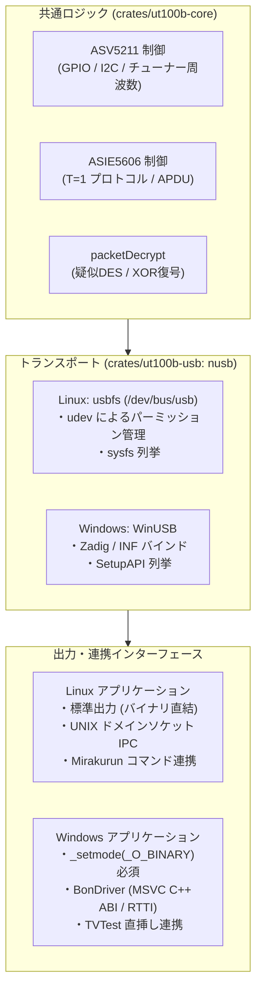
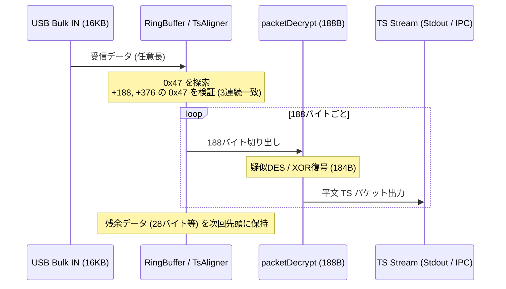

# QRS-UT100B Rust統一モダナイズ詳細設計書
〜 Linux / Windows クロスプラットフォーム実装における差異と最重要注意点 〜

## 1. はじめに

Quixun QRS-UT100B（ASICEN ASV5211 + ASIE5606）は、メーカー（クイックサン）の破産（2011年）により公式ソフトウェア・ドライバ（32bit XP/Vista 向け未署名 `.sys`）の供給が完全に途絶えたレガシーハードウェアです。
これまで Linux では 2008 年製の `recfriio` フォーク（C/C++、Boost 1.74 依存）が細々と使われてきましたが、Windows 10/11 64bit では未署名ドライバの強制無効化なしには動作すらしない状態でした。

先行する優良事例である [`i4M1k0SU/DTH10-series-driver`](https://github.com/i4M1k0SU/DTH10-series-driver)（BUFFALO DT-H10 シリーズを Rust + `nusb` + WinUSB で現代化）の設計思想を取り入れ、**Linux（Mirakurun / 録画サーバー）と Windows 11（TVTest 直挿し視聴）を単一の Rust コードベースで完全蘇生** させるための詳細技術調査と注意点をここにまとめます。

---

## 2. Linux と Windows での書き方・挙動・API の全差異



### (1) USB トランスポート層（`nusb` の挙動差異）

`nusb` は libusb などの C ライブラリを一切使わず、OS ネイティブの USB サブシステムを直接叩きます。

| 項目 | Linux (usbfs) | Windows (WinUSB) | コード上の差異・対策 |
|---|---|---|---|
| **バックエンド API** | カーネル `ioctl` (`/dev/bus/usb/BBB/DDD`) | `winusb.dll` (`WinUsb_ControlTransfer`, Overlapped I/O) | `nusb` が抽象化するためアプリケーションコードは 100% 共通 |
| **コントロール転送の Recipient 制限** | `0x40` (Device), `0x41` (Interface) ともに無制限 | **`0x41` (Interface) の場合、`wIndex & 0xFF == InterfaceNum` が強制される** | **朗報**: UT100B はベンダーリクエストに `0x40` (Device) を使用しているため、WinUSB でも弾かれない |
| **バルク転送メモリ配置** | メモリマップ（mmap）またはヒープバッファ | Overlapped I/O（ユーザー空間ヒープ） | 一部カーネルの mmap キャッシュ不整合を避けるため、`nusb::transfer::Buffer::new()`（ヒープ）を使用する |
| **アクセス権限** | `/etc/udev/rules.d/` でパーミッション付与 | WinUSB ドライババインド（Zadig / INF） | OS 側のセットアップ手順として文書化が必要 |

### (2) コールドブート（ファームウェア転送）時の OS 挙動差異

UT100B は電源投入時、未初期化の ROM 状態で起動し、ファームウェア転送後に USB チップが自己リセットして再列挙されます：
- **コールド状態**: VID `0x1738`, PID `0x5211`
- **ウォーム状態**: VID `0x3275`, PID `0x7020`

> [!WARNING]
> **Windows 特有の最大トラップ（WinUSB デュアルバインド問題）**:
> Linux では udev ルールで `1738:5211` と `3275:7020` の両方に `MODE="0666"` を書けば、同一プロセスがコールド状態を開いてファームウェアを送り、再列挙後にウォーム状態を開くことができます。
> しかし **Windows では、USB VID:PID ごとに個別のドライバがバインドされます**。
> ユーザーが Zadig で `3275:7020`（ウォーム状態）だけに WinUSB を当ててしまうと、PC 再起動や USB 抜き差しでコールド状態（`1738:5211`）に戻った際、Windows は「未認識のデバイス」として扱い、Rust プログラムから開けなくなります。
> **対策**:
> 1. Windows 向けには、`1738:5211` と `3275:7020` の両方を WinUSB にバインドするカスタム `.inf` ファイルを同梱する。
> 2. あるいは、コールド検出時に Zadig / `libwdi` で自動バインドを案内する診断機能を `ut100b-diag` に持たせる。

### (3) 標準出力のバイナリモード差異（Windows の改行コード変換トラップ）

Linux において `std::io::stdout()` は透過的なバイナリパイプですが、Windows の標準 C ランタイム（CRT）では標準出力がテキストモード（`_O_TEXT`）で初期化される場合があります。
テキストモードの場合、TS パケット内の `0x0A`（LF）が自動的に `0x0D 0x0A`（CR+LF）に書き換えられ、**放送波ストリームが不可逆的に破壊されます**。

- **Rust での対策**:
  Windows ターゲット時（`#[cfg(windows)]`）は、標準出力へのパイプ開始時に Win32 API または C ランタイムでバイナリモードを強制設定する：
  ```rust
  #[cfg(windows)]
  unsafe {
      use std::os::windows::io::AsRawHandle;
      let handle = std::io::stdout().as_raw_handle();
      // もしくは libc::_setmode(libc::_fileno(libc::stdout), libc::_O_BINARY);
  }
  ```

### (4) Windows TVTest BonDriver の MSVC C++ ABI & RTTI 差異

Windows で TVTest から直接チューナーを認識させるには、`BonDriver_UT100B.dll`（`cdylib`）を提供する必要があります。ここには Rust から C++ クラスを模倣する際の深い罠が存在します。

#### ① MSVC vtable の隣接オーバーロード逆順配置
MSVC コンパイラは、クラス定義で同一名称のオーバーロード関数が連続している場合、**vtable に逆順で関数ポインタを配置する** という仕様があります。
`IBonDriver` の `GetTsStream`:
```cpp
virtual const BOOL GetTsStream(BYTE *pDst, DWORD *pdwSize, DWORD *pdwRemain);   // (1)
virtual const BOOL GetTsStream(BYTE **ppDst, DWORD *pdwSize, DWORD *pdwRemain); // (2)
```
Rust 側の vtable 構造体定義では、**(2) の `BYTE **` を先に、(1) の `BYTE *` を後に定義** しなければなりません。これを間違えると、TVTest が呼び出した瞬間に不正ポインタアクセス（`0xC0000005`）でクラッシュします。

#### ② MSVC RTTI（`dynamic_cast`）の偽装
TVTest や LibISDB は、`CreateBonDriver()` で返されたポインタに対して `dynamic_cast<IBonDriver2*>` を実行します。
MSVC の `dynamic_cast` は vtable の直前（`vptr[-1]`）にある **Complete Object Locator (COL)** を走査し、型ディスクリプタの名前文字列（`".?AVIBonDriver2@@"`）を比較します。
Rust でこの MSVC RTTI メタデータ構造体を静的に配置して `vptr[-1]` にポインタを埋め込むことで、C++ コンパイラなしで `dynamic_cast` を成功させることができます（`DTH10-series-driver` の `rtti.rs` を完全準用）。

#### ③ FFI 境界でのパニック捕捉（Panic Safety）
Rust の `extern "system"` 関数からパニックが外側（C++ の TVTest 側）にアンワインドすると、未定義動作となりプロセスが即死（`abort`）します。
BonDriver の全エクスポート関数は `std::panic::catch_unwind(|| { ... })` でラップし、エラー時は安全に `FALSE` または `NULL` を返さなければなりません。

### (5) IPC（プロセス間通信）の差異

チューナー常駐デーモン（`ut100b serve`）とクライアント（`ut100b stream` / BonDriver）の間でストリームを中継する場合：
- **Linux**: UNIX ドメインソケット（`/run/ut100b/ut100b.sock`）
- **Windows**: 名前付きパイプ（`\\.\pipe\ut100b`）またはローカル TCP（`127.0.0.1:xxxxx`）
`tokio` を用いることで、プラットフォームごとに `tokio::net::UnixListener` と `tokio::net::windows::named_pipe::ServerOptions` を切り替えて綺麗に共通化可能です。

---

## 3. 書き換えにあたっての最重要注意ポイント (Critical Pitfalls)

### 注意点 1: TS パケット境界のアラインメントと 3 パケット同期検証

USB のバルク転送は 16,384 バイト（512 × 32）や 39,936 バイト（512 × 78）といった単位で届きますが、**これは 188 バイト（TS パケットサイズ）の整数倍ではありません**（例: `16384 = 188 * 87 + 28` バイト）。
バルク転送バッファの先頭が TS パケットの先頭（`0x47`）である保証は全くありません。

- **落とし穴**:
  バッファの先頭から無条件に `packetDecrypt` を適用すると、暗号化ブロックのオフセットが狂い、全ストリームがノイズ化します。
- **実装必須ロジック (`TsAligner`)**:
  1. `ring_buffer` に受信データを蓄積。
  2. `0x47`（同期バイト）を探索。
  3. `pos + 188` および `pos + 376` の位置にも `0x47` が存在するか（**3パケット連続同期**）を検証。
  4. 同期が確認された場合のみ、188 バイト単位で `packetDecrypt` に引き渡す。
  5. 途中で同期が崩れた場合は、次の `0x47` までスキップ（再同期）する。



### 注意点 2: ハードウェア暗号復号（`packetDecrypt`）の最適化

UT100B のハードウェア XOR / 疑似 DES 暗号は、パケットごとに 8 バイト単位の換字・転置ラウンドを 8 回繰り返します。
- **テーブルサイズ**: `table[8][64]`（`uint32_t` × 512 = 2,048 バイト、L1 キャッシュに完全収容可能）。
- **注意点**:
  Rust で実装する際、スライスインデックス境界チェック（Bounds Check）がループ内で走るとスループットが低下します。
  `const TABLE: [[u32; 64]; 8]` として定数定義し、ビット演算（`& 0x3F`）により 64 要素未満であることがコンパイラに自明な形に記述することで、境界チェックをゼロにし、LLVM によるレジスタ割り当て・インライン展開を最大化させます。

### 注意点 3: USB バルク転送の連続読み込みキュー（In-flight Depth）

地デジの TS レートは約 17 Mbps（約 2.1 MB/s）に達します。
シングルバッファで「読み込み完了 → 復号処理 → 次の読み込み要求」と同期的に処理していると、復号処理中に ASV5211 内部のハードウェア FIFO（数 KB 程度）が溢れ、**パケットドロップ（Drop / Continuity Counter Error）** が発生します。

- **対策**:
  常に **4 〜 8 個の転送要求をカーネル/ドライバ側に先行投入（In-flight）** しておきます。
  `nusb` の `StreamReader` パターンを用い、1 つのバッファが完了したら即座に次の空バッファを `submit` してから受信データを処理スレッドへ流す非同期パイプライン構成にします。

### 注意点 4: 内蔵 B-CAS（ASIE5606）と Multi2 復号方式

UT100B には内蔵 B-CAS スロット（ASIE5606）があり、ASV5211 を経由して T=1 プロトコルで APDU を送受信できます。
しかし、B-CAS カード自体は **ECM から暗号鍵（Multi2 スクランブル鍵）を取り出すだけ** であり、**TS パケット自体の Multi2 デスクランブル（ARIB STD-B25）はホストの CPU が行う必要があります**。

- **構成の選択肢**:
  1. **内部完結方式（推奨）**:
     CLI 内部に純粋な Rust 製 Multi2 復号器（ARIB B25 Section Parser）を組み込み、`ut100b tune -c 19` だけで完全に復号済みのクリーンな TS を標準出力に吐き出す。
     → Mirakurun に外部 B25 フィルタを噛ませる必要がなくなり、運用が極めてシンプルになる。
  2. **Raw 出力方式**:
     内蔵 B-CAS を使わず、放送波のまま（暗号化されたまま）TS を出力し、Mirakurun 側の `arib-b25-stream-test` や PC/SC カードリーダーに復号を任せるモード（`--raw`）も備えておく。

---

## 4. 推奨 Cargo ワークスペース構成

`i4M1k0SU/DTH10-series-driver` をベースにした、最も洗練されたワークスペース設計です：

```
qrs-ut100b-driver/
├── Cargo.toml                  # ワークスペース定義 (resolver = "2")
├── Cargo.lock
├── README.md
├── licenses/                   # パッケージ別ライセンス
├── firmware/
│   └── asv5211-firmware.bin    # 抽出済みファームウェア (16KB)
├── crates/
│   ├── ut100b-core/            # 【プラットフォーム非依存】ハードウェア制御・暗号コア
│   │   ├── Cargo.toml
│   │   └── src/
│   │       ├── lib.rs
│   │       ├── asv5211.rs      # ASV5211 USB ベンダーリクエスト (0x40/0xC0)
│   │       ├── asie5606.rs     # ASIE5606 スマートカード制御 (T=1, APDU)
│   │       ├── decrypt.rs      # TS packetDecrypt (疑似DES / XOR)
│   │       └── tuner.rs        # Hdp 周波数計算テーブル (UHF 13-62ch, CATV)
│   │
│   ├── ut100b-usb/             # 【USB トランスポート】nusb ラッパー
│   │   ├── Cargo.toml
│   │   └── src/
│   │       ├── lib.rs
│   │       ├── device.rs       # デバイス検出・コールド/ウォーム判定・オープン
│   │       ├── firmware.rs     # コールド状態 (1738:5211) へのファーム転送
│   │       └── stream.rs       # StreamReader (In-flight キュー付きバルク受信)
│   │
│   ├── ut100b-tuner/           # 【ストリーム処理】同期・B-CAS・復号管理
│   │   ├── Cargo.toml
│   │   └── src/
│   │       ├── lib.rs
│   │       ├── aligner.rs      # 3パケット連続 0x47 同期検証
│   │       ├── bcas.rs         # B-CAS セッション管理・ECM 鍵取得
│   │       └── multi2.rs       # ARIB STD-B25 TS デスクランブル (純Rust)
│   │
│   ├── ut100b-cli/             # 【Linux / Windows CLI】チューナー実行バイナリ
│   │   ├── Cargo.toml
│   │   └── src/
│   │       ├── main.rs
│   │       ├── tune.rs         # ut100b tune -c 19 (Mirakurun パイプ出力)
│   │       ├── serve.rs        # ut100b serve (ソケット常駐デーモン)
│   │       └── stream.rs       # ut100b stream (デーモン接続クライアント)
│   │
│   ├── ut100b-bondriver/       # 【Windows 専用】TVTest 用 BonDriver DLL
│   │   ├── Cargo.toml          # crate-type = ["cdylib"]
│   │   ├── BonDriver_UT100B.ini
│   │   └── src/
│   │       ├── lib.rs          # IBonDriver / IBonDriver2 C++ vtable 実装
│   │       ├── rtti.rs         # MSVC RTTI (dynamic_cast 偽装テーブル)
│   │       └── client.rs       # ut100b serve または直接デバイス接続
│   │
│   └── ut100b-diag/            # 【開発・保守用】診断・テスト CLI
│       ├── Cargo.toml
│       └── src/
│           ├── main.rs         # レジスタ読み書き、CNR 信号測定、ATR テスト
```

---

## 5. 結論と次のステップ

### 調査の総括
1. **Linux / Windows の統一は完全に実現可能**:
   - `nusb` を使うことで、USB アクセスコードは 100% 共通化できます。
   - UT100B が採用しているベンダーリクエスト（`0x40` / `0xC0`: Device Recipient）は、WinUSB の厳しいインターフェースチェックに引っかからないため、Windows 移植のハードルが非常に低いです。
2. **最大の注意点は「ファームウェア再列挙の Windows 側扱い」と「TS 3 パケット同期」**:
   - Windows 側での `1738:5211`（コールド）への WinUSB バインド対策。
   - USB バルク転送境界（512バイト倍数）と TS パケット長（188バイト）のズレを吸収する堅牢な同期バッファの実装。
   - TVTest 連携時の MSVC vtable 逆順配置と RTTI 対応。

この詳細設計に基づき、まずは **`crates/ut100b-core` のプロトコル移植** と **`crates/ut100b-usb` の `nusb` 導通テスト** から着手することを推奨いたします。
